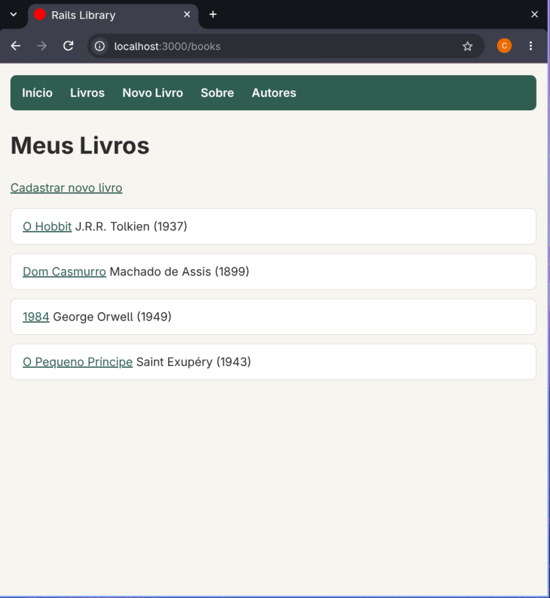
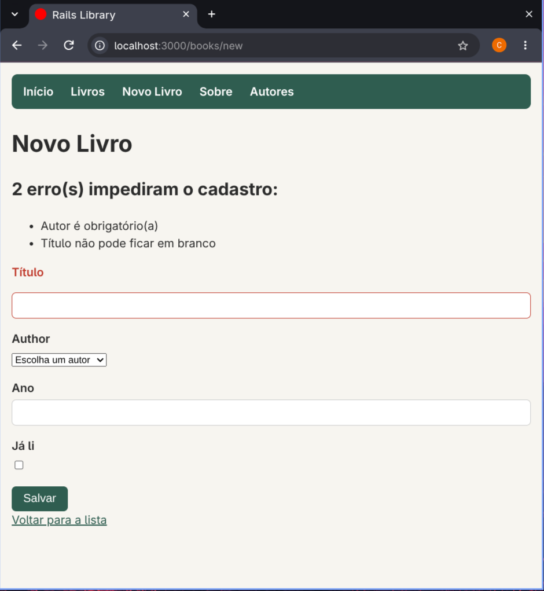
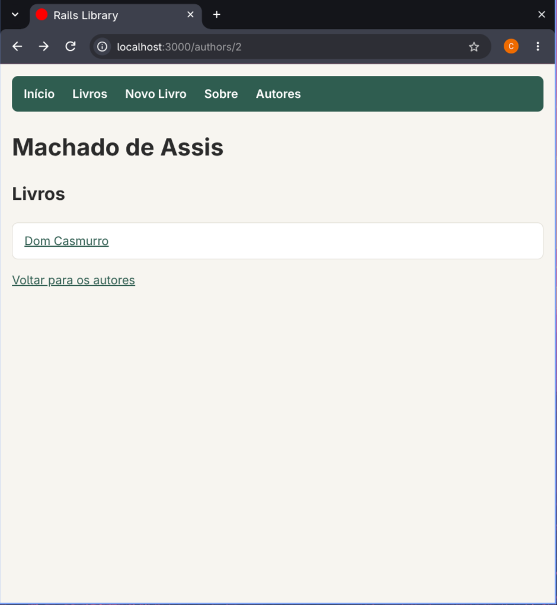

# README

# 📚 RailsLibrary

Uma biblioteca pessoal feita em **Ruby on Rails**: dá pra cadastrar livros, ver os detalhes de cada um, editar, apagar e organizar tudo por autor.

Mas, sendo bem sincero, o mais importante desse projeto não é a biblioteca em si. Ele é o registro do meu **primeiro contato com um framework**. Antes dele eu nunca tinha usado nenhum, nem Rails, nem nada parecido. Então a ideia aqui foi aprender de verdade, passo a passo, entendendo o porquê de cada coisa em vez de só copiar código.

---

## 🧭 Por que esse projeto existe

Eu estudo Engenharia de Software e vinha programando em Java e Python. Quando comecei a mexer com Ruby, fiz primeiro um projetinho de terminal (uma biblioteca com array de hashes, `each`, `select`, essas coisas). Funcionava, mas tinha um problema: fechou o programa, perdeu tudo.

Aí veio a vontade de dar o próximo passo: transformar aquela ideia num **site de verdade**, com banco de dados, páginas, formulários e tudo mais. E foi assim que o RailsLibrary nasceu.

Uma coisa que eu fiz questão desde o começo: **nada de `rails generate scaffold`**. O scaffold cria tudo de uma vez e esconde justamente o que eu queria aprender. Então eu montei cada rota, cada controller, cada view e cada migration na mão, peça por peça.

---

## ✨ O que o projeto faz

- **Lista todos os livros** cadastrados, com título, autor e ano
- **Mostra os detalhes** de cada livro (título, autor, ano e se eu já li)
- **Cadastra livros** por um formulário
- **Edita** e **apaga** livros (com aquela confirmação de "tem certeza?" antes de apagar)
- **Valida os dados**: não dá pra salvar livro sem título, sem autor ou com ano negativo
- **Cadastra autores** e liga cada livro ao seu autor
- **Página de cada autor** mostrando todos os livros que ele escreveu
- **Mensagens de confirmação** depois de cada ação ("Livro cadastrado com sucesso.")
- **Tudo em português**, inclusive as mensagens de erro
- **Visual próprio**, com CSS escrito do zero (sem framework de CSS)

---

## 🛠️ Tecnologias

| Tecnologia | Versão | Pra quê |
| --- | --- | --- |
| Ruby | 3.4 | a linguagem |
| Rails | 8.1 | o framework |
| SQLite | 3 | o banco de dados (é só um arquivo, não precisa instalar servidor) |
| rails-i18n | — | traduções do Rails pra português |
| CSS puro | — | o visual, escrito na mão |

E o ambiente onde eu desenvolvi:

- **Omarchy** (Arch Linux + Hyprland) como sistema operacional
- **mise** pra gerenciar a versão do Ruby
- **Neovim com LazyVim** como editor
- **Git e GitHub** com uma branch e um Pull Request pra cada parte do projeto

---

## 📸 Telas

<!-- Coloque os prints na pasta docs/images e ajuste os nomes abaixo -->

| Lista de livros | Formulário com erro | Página do autor |
| --- | --- | --- |
|  |  |  |

---

## 🚀 Como rodar o projeto na sua máquina

Você vai precisar ter o **Ruby 3.4**, o **Rails 8.1** e o **SQLite** instalados.

**1. Clone o repositório e entre na pasta**

```bash
git clone git@github.com:christiantakahashi/RailsLibrary.git
cd RailsLibrary
```

**2. Instale as gems (as dependências do projeto)**

```bash
bundle install
```

**3. Crie o banco de dados e as tabelas**

```bash
bin/rails db:migrate
```

Esse comando roda todas as migrations, que são as "instruções" pra construir as tabelas. O arquivo do banco não vai pro GitHub (ele fica no `.gitignore`), então cada pessoa monta o seu.

**4. Ligue o servidor**

```bash
bin/rails server
```

**5. Abra no navegador:** [http://localhost:3000](http://localhost:3000)

> **Dica:** o banco começa vazio. Cadastre primeiro um autor em **Autores**, e depois os livros, porque todo livro precisa ter um autor.

---

## 🗺️ Como o projeto foi construído

Eu dividi tudo em partes. Cada parte virou uma branch, um Pull Request e um merge na `main`, do jeito que se trabalha numa empresa.

| Parte | O que eu fiz | O que eu aprendi |
| --- | --- | --- |
| 1. Ambiente | configurei Ruby, Rails e SQLite | a diferença entre o Ruby do sistema e o do mise (e resolvi um conflito de gems no caminho) |
| 2. Projeto | `rails new`, primeiro commit e repositório no GitHub | pra que serve cada pasta do Rails |
| 3. Primeira página | rota, controller e view da página inicial | o caminho de um pedido: **rota → controller → view** |
| 4. Model e banco | migration, tabela `books` e model `Book` | como uma tabela vira uma classe (Active Record) |
| 5. Console | CRUD inteiro direto no terminal | `Book.all`, `find`, `create`, `update`, `destroy` e o SQL que cada um gera |
| 6. Listar e mostrar | páginas `/books` e `/books/:id` | `params`, `each` na view e `link_to` |
| 7. Cadastrar | formulário com `form_with` | strong parameters e por que usar `redirect_to` depois de salvar |
| 8. Validações | regras no model | a diferença entre `render` e `redirect_to` |
| 9. Editar | `edit` e `update` | o verbo PATCH (essa eu fiz praticamente sozinho) |
| 10. Apagar | `destroy` com confirmação | o verbo DELETE, o `button_to` e o status 303 |
| 11. Acabamento | `resources`, partial, flash, layout, CSS e traduções | refatoração: mudar o código sem mudar o comportamento |
| 12. Autores | tabela `authors` ligada a `books` | chave estrangeira, `has_many` e `belongs_to` |

---

## 🧠 O que eu aprendi de mais importante

### O caminho de um pedido (MVC)

Todo pedido no Rails percorre o mesmo caminho. Eu entendi isso pensando num restaurante:

```
navegador → rota → controller → model ↔ banco → controller → view → navegador
```

- **Rota** (`config/routes.rb`) é a **recepção**: diz quem vai atender cada endereço
- **Controller** é o **garçom**: recebe o pedido, busca o que precisa e entrega
- **Model** é a **cozinha**: o único que conversa com o banco de dados
- **View** é o **prato**: o HTML que a pessoa vê

Uma coisa que demorou pra cair a ficha: **os arquivos não se chamam entre si**. Não tem `import` nenhum. Quem liga tudo é o próprio Rails, como um gerente no meio.

### Convenção sobre configuração

Essa foi a parte que mais me travou no começo, e acho que vale explicar. O Rails não guarda uma lista dizendo onde está cada arquivo. Ele **monta o caminho juntando palavras**, tipo uma f-string do Python:

```python
controller = "books"
acao = "show"
f"app/controllers/{controller}_controller.rb"   # app/controllers/books_controller.rb
f"app/views/{controller}/{acao}.html.erb"        # app/views/books/show.html.erb
```

Por isso os nomes importam tanto. Uma letra errada e a ligação quebra. Eu aprendi isso na prática quando criei um arquivo chamado `pages_contoller.rb` (faltando um "r") e passei um tempo sem entender por que o Rails não achava o controller 😅

E a regra dos nomes, que no fim é bem lógica:

| Nome | O que é |
| --- | --- |
| `Book` | o model (classe com maiúscula, singular porque descreve **um** livro) |
| `books` | a tabela (plural porque guarda **vários**) |
| `BooksController` | o controller (plural porque cuida da coleção) |
| `@book` / `@books` | um livro / vários livros, indo do controller pra view |

### O `@` que leva os dados até a view

Uma variável sem `@` morre no `end` do método. Com `@`, ela continua viva e o Rails entrega pra view. Parece detalhe, mas foi a causa de vários erros meus (`undefined local variable or method 'book'`, quem nunca).

### `render` x `redirect_to`

- **`redirect_to`**: manda o navegador fazer um pedido novo. Uso quando **deu certo**.
- **`render`**: mostra a view no mesmo pedido, então os dados digitados e os erros continuam lá. Uso quando **deu errado** e a pessoa precisa corrigir.

### Relacionamento entre tabelas

Na última parte, o autor deixou de ser só um texto e virou uma tabela própria. Cada livro guarda o `author_id`, que aponta pro autor certo:

```ruby
class Author < ApplicationRecord
  has_many :books        # um autor tem muitos livros
end

class Book < ApplicationRecord
  belongs_to :author     # um livro pertence a um autor
end
```

Com essas duas linhas, `book.author` e `author.books` já funcionam. Achei isso muito massa.

### Ler mensagem de erro

Parece bobo, mas foi uma das coisas que mais evoluí. No começo eu via a página vermelha e travava. Depois aprendi a procurar a linha certa, olhar o `Parameters` no rodapé, ler o `Did you mean?` e entender que muitas vezes **o erro aparece numa linha depois** de onde ele realmente está (geralmente é algo que abri e esqueci de fechar).

---

## 📁 Estrutura dos arquivos principais

```
app/
├── controllers/
│   ├── books_controller.rb      # index, show, new, create, edit, update, destroy
│   ├── authors_controller.rb    # index, show, new, create
│   └── pages_controller.rb      # página inicial e "Sobre"
├── models/
│   ├── book.rb                  # validações + belongs_to :author
│   └── author.rb                # validações + has_many :books
├── views/
│   ├── books/                   # index, show, new, edit e o partial _form
│   ├── authors/                 # index, show e new
│   ├── pages/                   # home e about
│   └── layouts/
│       └── application.html.erb # menu e mensagens de confirmação
└── assets/stylesheets/
    └── application.css          # todo o CSS do projeto
config/
├── routes.rb                    # resources :books e resources :authors
└── locales/pt-BR.yml            # nomes dos models e campos em português
db/
├── migrate/                     # o histórico de mudanças do banco
└── schema.rb                    # o retrato atual do banco
```

---

## 🔜 Próximos passos

Coisas que eu ainda quero fazer nesse projeto:

- [ ] Editar e apagar autores
- [ ] Busca de livros por título
- [ ] Filtro de livros lidos e não lidos
- [ ] Escrever testes automatizados
- [ ] Colocar o projeto no ar (deploy)

---

## 👤 Autor

Feito por **Christian Yukio de Oliveira Takahashi**, estudante de Engenharia de Software na UEM, aprendendo Rails um erro de cada vez.

[LinkedIn](https://www.linkedin.com/in/christian-yukio-a9b823388)
